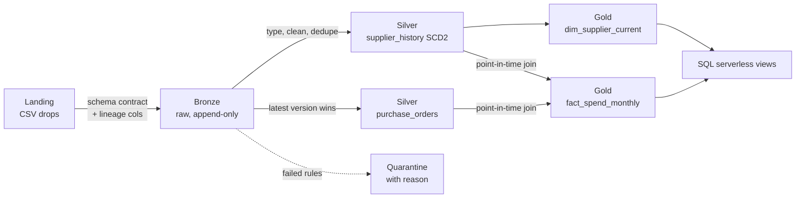

# Medallion Lakehouse Demo

[](https://github.com/<your-username>/medallion-lakehouse-demo/actions/workflows/ci.yml)

A small, fully tested PySpark pipeline that shows the patterns behind a production lakehouse:
**medallion layers, SCD Type 2 historization, idempotent incremental loads, quarantine of bad rows,
data quality gates, and point-in-time joins.**

It runs locally in about a minute on fictional procurement data (suppliers and purchase orders).
The same code targets Delta Lake on Databricks or Azure Synapse Spark with `--format delta`.



## What it demonstrates

| Pattern | Where | Why it matters |
|---|---|---|
| Source contract on ingestion | `bronze.py` | A renamed or missing column fails fast instead of loading nulls. |
| Idempotent incremental ingestion | `bronze.py`, `pipeline.py` | Files already in bronze are skipped; re-running the job changes nothing. |
| SCD Type 2 as a pure function | `scd2.py` | Easy to unit-test, works with Parquet or Delta. Handles changes, deletions (tombstones) and reactivations. |
| Null-safe change detection | `scd2.row_hash` | `NULL` and `""` are different values; separators can't collide. |
| Quarantine instead of drop | `silver.split_valid_invalid` | Bad rows are kept with a reason (`unknown supplier_id`, `missing amount`…) for follow-up. |
| Late corrections | `silver.latest_per_order` | A purchase order re-sent in a later batch replaces the earlier version. |
| Point-in-time join | `gold.fact_spend_monthly` | Spend is reported under the category the supplier had *when the order was placed*, so history isn't silently restated. |
| Quality gates | `quality.py` | One current row per key, contiguous validity windows, unique keys, not-null. A failure stops the run. |

## The sample data tells a story

`data/landing/` holds three monthly supplier snapshots and three purchase order files with deliberate edge cases:

- **S001** changes payment terms in February, **S004** is re-categorised (Services → IT Services) and **S002** moves country in March → new SCD2 versions.
- **S003** disappears from the March snapshot → closed and tombstoned (`is_deleted = true`).
- **S005** appears twice in the February file → deduplicated.
- **PO-1008** references an unknown supplier and **PO-1011** has no amount → quarantined.
- **PO-1006** is re-sent in March with a corrected amount → the correction wins.

Resulting supplier history:

| supplier_id | category | country | valid_from | valid_to | is_current | is_deleted |
|---|---|---|---|---|---|---|
| S002 | Logistics | NL | 2026-01-01 | 2026-03-01 | false | false |
| S002 | Logistics | BE | 2026-03-01 | 9999-12-31 | true | false |
| S003 | Office | DE | 2026-01-01 | 2026-03-01 | false | false |
| S003 | Office | DE | 2026-03-01 | 9999-12-31 | true | **true** |
| S004 | Services | GB | 2026-01-01 | 2026-02-01 | false | false |
| S004 | IT Services | GB | 2026-02-01 | 9999-12-31 | true | false |

Because of the point-in-time join, S004's January order is reported under *Services* and its later orders under *IT Services*.

## Quick start

Requirements: Python 3.10+ and Java 11 or 17 (for Spark).

```bash
python -m venv .venv && source .venv/bin/activate
pip install -e ".[dev]"

make test   # 12 tests: unit + end-to-end
make run    # writes data/lake/{bronze,silver,gold,quarantine}
```

Sample output:

```
Bronze
  suppliers: 3 new batch(es) ['2026-01-01', '2026-02-01', '2026-03-01']
  purchase_orders: 3 new batch(es) ['2026-01', '2026-02', '2026-03']
Silver
  supplier_history: applying batch(es) ['2026-01-01', '2026-02-01', '2026-03-01']
  [PASS] scd2: exactly one current row per key (0 failing rows)
  [PASS] scd2: validity windows contiguous, no overlaps (0 failing rows)
  purchase_orders: 9 valid, 2 quarantined
  [PASS] purchase_orders: po_id is unique (0 failing rows)
  [PASS] purchase_orders: po_id, supplier_id, order_date, amount not null (0 failing rows)
Gold
  dim_supplier_current: 4 rows
  fact_spend_monthly: 9 rows
```

Run it a second time: nothing new is ingested and the history is unchanged. Drop a new
`suppliers_2026-04-01.csv` into `data/landing/suppliers/` and only that batch is applied.

### Delta Lake

```bash
pip install -e ".[dev,delta]"
python -m lakehouse.pipeline --root data --format delta
```

Delta gives ACID overwrites and time travel. The Parquet mode is there so tests and CI need no extra jars;
it swaps tables through a staging folder on the local filesystem and is not meant for a shared lake.

### Querying from SQL

`sql/serverless_views.sql` exposes the gold tables through Azure Synapse serverless SQL with `OPENROWSET`,
including an "as of a date" query over the supplier history.

## Project layout

```
src/lakehouse/
  config.py     paths for each layer
  spark.py      SparkSession factory (Parquet or Delta)
  io.py         format-agnostic read / overwrite / append
  bronze.py     landing -> bronze, schema contract, lineage, idempotency
  scd2.py       SCD Type 2 merge (pure DataFrame function)
  silver.py     typing, dedupe, quarantine, late corrections
  gold.py       current dimension, point-in-time spend fact
  quality.py    data quality checks and gate
  pipeline.py   orchestration + CLI
tests/          unit tests per module + end-to-end tests on the sample data
sql/            serverless SQL views over the gold layer
```

## Design notes

- **Snapshot semantics.** Supplier files are full snapshots, so a missing key means "deleted at the source".
  For delta (change-only) feeds, skip the tombstone branch in `apply_scd2`.
- **Effective time = batch date.** Each snapshot's date (from its file name) becomes `valid_from`.
  Batches are applied oldest first, and only batches newer than the latest `valid_from` are applied,
  so replaying old files cannot corrupt history.
- **Half-open intervals.** `valid_from <= t < valid_to`, so consecutive versions never overlap and a
  point-in-time lookup always returns exactly one row.
- **Tombstones keep the last attributes.** Late facts for a deleted supplier still resolve to a category.

## License

MIT. All data in this repository is fictional.
